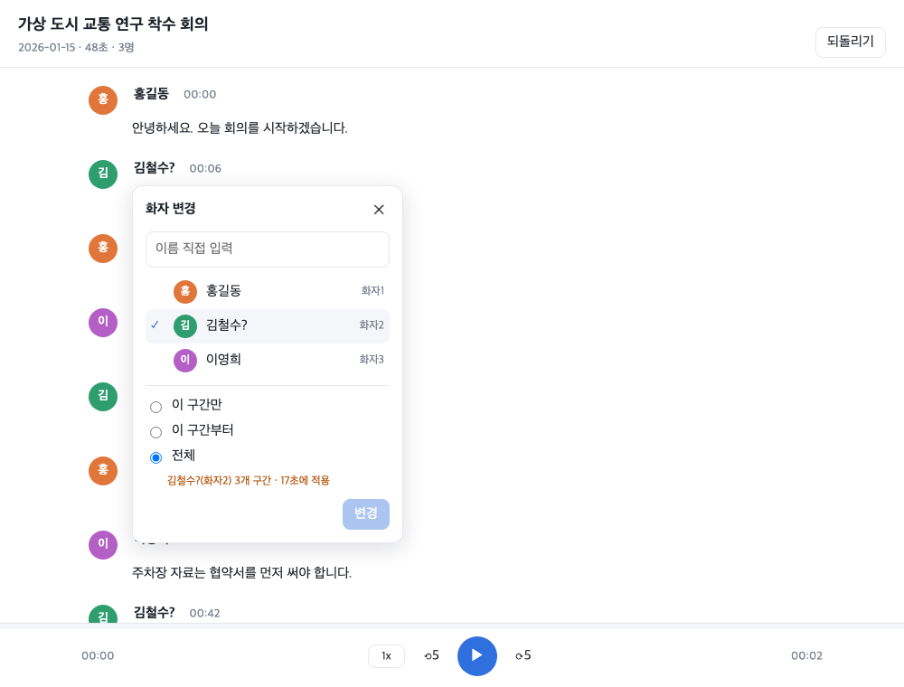

# rec2md

녹음 파일(회의·전화·강연)을 **화자 구분 녹취록 Markdown + 요약**으로 바꾸고, 그 녹취로 **양식에 맞춘 회의록**(md·html·hwpx·docx, pdf·png)을 만드는 CLI와 Claude Code·Codex 스킬.

- 로컬 STT 우선(Apple Silicon: mlx-whisper + pyannote). 녹음은 이 맥 밖으로 나가지 않는다. 클라우드(RTZR, CLOVA Speech)는 품질 기준점·보조
- 엔진 공통 스키마 `segments.json` → raw Markdown → 에이전트가 화자 이름 정리·문단화·요약
- 회의 시리즈 용어집과 회의 자료로 고유명사 오인식을 줄이고, 고칠 후보만 골라 준다
- 회의록은 에이전트가 `minutes.json`을 쓰고 `rec2md render`가 양식(국내 기관 공통, 제주연구원, 사용자 양식)에 맞춰 찍는다

> 상태(2026-10-30): 전사·화자분리, 맥락 보정(`series`), 회의록 렌더(`render`), 화자 목소리 DB(`voices`), 검토 화면(`review`), 클로바식 녹취록 내보내기(`render --kind transcript`), 폴더 일괄 처리(`batch`), 녹음기를 안 끈 긴 무음 자르기 동작. 설계는 [`docs/PLAN.md`](docs/PLAN.md).

## 설치 (Apple Silicon Mac)

```sh
brew install ffmpeg
uv tool install --editable '.[diarize,render,export,office]'
```

필요한 것만 골라 설치한다.

| extra | 쓰는 곳 | 들어가는 것 |
|---|---|---|
| `diarize` | 화자분리 | pyannote.audio (Hugging Face 토큰 필요, 아래) |
| `render` | `rec2md render` md·html | Jinja2 |
| `export` | `--export pdf,png` | pypdfium2, Pillow. html → pdf는 Chrome(없으면 WeasyPrint) |
| `office` | `rec2md render` docx·hwpx | python-docx, docxtpl. docx → pdf는 LibreOffice, hwpx → pdf·png는 rhwp + rsvg-convert |
| `voices` | 화자 목소리 DB 매칭 | NumPy, SciPy (`diarize`를 깔았으면 이미 들어 있음) |

빠진 패키지·도구가 있으면 명령이 무엇을 설치하면 되는지 알려 준다.

화자분리(pyannote)는 Hugging Face 토큰이 필요하다.
1. https://hf.co/pyannote/speaker-diarization-community-1 에서 약관 동의
2. https://hf.co/settings/tokens 에서 read 토큰 발급
3. `~/.config/rec2md/.env` 에 `HF_TOKEN=hf_...`

## 명령 요약

| 명령 | 하는 일 | 상태 |
|---|---|---|
| `rec2md <파일...>` | 전사 + 화자분리 → `<이름>.segments.json`, `<이름>.raw.md` | 동작 |
| `rec2md series ...` | 회의 시리즈 용어집·참석자 관리, 보정 후보 뽑기 | 동작 |
| `rec2md render ...` | 회의록 JSON → 양식 회의록 (md·html·docx·hwpx, pdf·png) | 동작 |
| `rec2md notes <segments.json> <메모>` | 회의 메모 문단마다 녹취 근거 구간 후보 → 에이전트가 메모 보정본 작성 | 동작 |
| `rec2md render --kind transcript ...` | segments.json → 클로바노트식 녹취록 (txt·md·html) | 동작 |
| `rec2md voices ...` | 목소리 등록, 새 녹취에 실명 자동 태깅 | 동작 |
| `rec2md batch <폴더>` | 폴더 일괄 전사, `--dry-run`(길이·추정 말소리 길이·예상 시간), 중단 후 이어서 | 동작 |
| `rec2md review <segments.json>` | 문장 클릭 재생 + 화자 고치기 (이 맥에서만 열리는 웹 화면) | 동작 |
| `rec2md review --queue <cases.json>` | 사례를 하나씩 듣고 판정 → `answers.json` (평가 정답) | 동작 |

### 전사

```sh
rec2md meeting.m4a                 # → meeting.segments.json, meeting.raw.md
rec2md call.mp3 --speakers 2       # 화자 수를 알면 지정
rec2md talk.mov --no-diarize       # 영상도 됨, 화자분리 생략
rec2md long.mp3 --no-trim          # 긴 무음을 자르지 않고 그대로 처리
rec2md long.mp3 --trim-min-gap 10  # 10분 이상 이어진 무음만 자름 (기본 5분)
```

녹음기를 끄지 않아 뒤에 몇 시간씩 붙은 무음은 **전사 전에 잘라낸다.** 소리 크기로 5분 이상(`--trim-min-gap <분>`으로 바꿈) 조용한 구간을 찾아 빼고 말소리 구간만 이어 붙여 화자분리·전사하며, 결과의 시각은 원본 녹음 기준이다. 잘라낸 구간은 `segments.json`의 `meta.trim.cut`에, 그중 약한 소리가 있어 다시 들어 볼 만한 구간은 `meta.trim.review`에 남는다. 아주 작게 말한 부분까지 잘릴까 걱정되면 `--no-trim`으로 끈다(시간·메모리는 더 든다).

```sh
rec2md batch ~/녹음 --dry-run      # 파일별 길이·추정 말소리 길이·판정·예상 처리시간만 보기
rec2md batch ~/녹음                # 차례로 전사 → ~/녹음/_transcripts/, 중단 후 같은 명령으로 이어서
                                   # --no-trim·--trim-min-gap도 그대로 받는다(dry-run 추정에도 반영)
```

### 맥락 보정 (회의 시리즈 용어집)

같은 회의가 반복되면 시리즈를 만들어 용어·참석자·오인식 교정을 쌓는다. 전사 때 Whisper에 맥락으로 넘기고, 고칠 후보를 `<이름>.corrections.json`으로 뽑는다(자동으로 고치지는 않는다).

```sh
rec2md series init 정례회의 --from-clova 지난회차.txt        # 클로바노트 txt에서 참석자 가져오기
rec2md series add 정례회의 --term "정답 표기" --fix "오인식 => 정답" --attendee "홍길동=소속" --doc 자료.pdf
rec2md series show 정례회의 --prompt                          # 전사에 넘길 맥락 확인
rec2md meeting.m4a --series 정례회의 --context 안건.hwpx      # 이번 회의 자료도 함께
rec2md series candidates 정례회의 meeting.segments.json       # 이미 전사한 것에서 후보만
```

시리즈는 `~/.config/rec2md/series/<이름>/`에 저장된다(개인 데이터, 레포 밖).

### 화자 실명 (목소리 DB)

화자분리를 켜고 전사하면 `<이름>.voices.npz`(화자별 목소리 임베딩)가 함께 생긴다. 녹취록을 확인한 뒤 화자를 등록해 두면, 다음 전사부터 같은 사람에게 실명이 자동으로 붙는다(`홍길동(화자3)`, 불확실하면 `홍길동?(화자3)`).

```sh
rec2md voices enroll meeting.segments.json --map "화자1=홍길동,화자3=김철수"   # 발화 30초 미만 화자는 거절
rec2md voices enroll meeting.segments.json --from-names   # 검토 화면에서 사용자가 지정한 이름을 등록
rec2md voices name meeting.segments.json --map "화자1=홍길동"   # 확인한 이름을 녹취에 기록(검토 화면과 같은 source "user")
rec2md voices list | rename <옛 이름> <새 이름> | forget <이름>
rec2md voices match old.segments.json                     # 예전에 전사한 것에 다시 이름 붙이기
rec2md meeting.m4a --no-voices                            # 자동 태깅 끄기
```

- 사람마다 녹취별 임베딩을 여러 개 저장하고 가장 비슷한 것으로 매칭한다. 한 녹취에서 한 사람은 한 화자에만 붙는다.
- 임계값(0.75) 미만이면 이름을 붙이지 않는다. 틀린 이름이 이름 없음보다 해롭기 때문이다. 근거는 `docs/PLAN.md` "화자 목소리 DB 평가".
- 등록할 때 화자 안에서 목소리가 크게 다른 구간은 빼고 등록하며, 많이 섞였으면 그 구간 시각과 함께 경고한다.
- 이미 등록된 사람인데 기존 목소리와 닮지 않으면 등록을 거절한다(이름을 잘못 줬을 가능성). 원거리 녹음처럼 확실할 때만 `--force`. 다른 사람과 점수가 비슷하면 `이름?`로 표시한다.
- DB는 `~/.config/rec2md/voices/voices.db`(권한 600)다. 목소리 임베딩은 생체정보이므로 옮기거나 공유하지 않는다.

### 회의록

에이전트(스킬)가 녹취록을 읽고 `<이름>.minutes.json`을 쓴다. 스키마는 [`docs/minutes-schema.md`](docs/minutes-schema.md). 그다음:

```sh
rec2md render --list-templates
rec2md render meeting.minutes.json --template kr-standard --format md,html --export pdf,png
rec2md render meeting.minutes.json --template ji --format hwpx,docx
```

- 결과는 JSON 옆에 `meeting.md`, `meeting.html`, `meeting.hwpx`, `meeting.pdf`, `meeting.p1.png`(쪽마다)… `--out`으로 폴더를 바꾼다.
- html 없이 docx·hwpx를 같이 pdf·png로 내보내면 `meeting.docx.pdf`, `meeting.hwpx.p1.png`처럼 형식별로 나뉜다.

#### 내 양식·회사 양식 쓰기

양식은 폴더 하나다. `~/.config/rec2md/templates/<이름>/`에 두면 내장 양식보다 먼저 쓰인다.

```
~/.config/rec2md/templates/
  ji/
    form.hwpx          # 회사 회의록 원본. 내장 ji의 필드 매핑으로 채운다
  mylab/
    template.toml      # 필드 → 칸 매핑, 회의내용 서식
    form.docx          # (선택) 형식별 원본: form.hwpx, form.docx, page.html.j2, page.md.j2
```

- **회사 원본 파일은 레포에 넣지 않는다.** 내장 `ji`처럼 매핑은 레포에 있고 원본만 사용자 폴더에 두면, 매핑은 그대로 쓰면서 원본만 바꿔 끼운다. 원본이 없으면 내장 골격으로 만든다.
- `template.toml`을 두면 그 양식은 사용자 것 하나만 읽는다(내장과 섞지 않음). 원본 파일은 사용자 폴더 → 내장 순으로 파일마다 찾는다.
- 칸 이름(`label`), 원본에서 찾을 칸 글자(`anchor`, 공백 무시), 값 칸 위치(`where = "right"|"below"`), 한 줄에 나란히 둘 칸(`row`) 등 스키마는 [`docs/templates.md`](docs/templates.md).

### 회의 메모 보정

회의 중에 타이핑한 메모(md·txt·docx·hwpx)가 있으면 녹취와 맞춰 본다.

```sh
rec2md notes meeting.segments.json 메모.docx [--series 정례회의] [--to-series 정례회의]
```

- `meeting.notes-align.json`: 메모 문단마다 녹취 근거 후보 구간, 녹취에 없는 숫자·인명·용어, 메모가 다루지 않은 녹취 구간. 키워드·숫자(단위 포함)·인명 겹침으로 찾는다.
- 무엇이 틀렸는지 판단하고 보정본(`메모.보정.md`, 바꾼 줄마다 `[타임스탬프]` 근거)을 쓰는 것은 스킬의 에이전트가 한다. 원본 메모는 그대로 둔다.
- `--to-series`는 메모를 시리즈 자료로 넣어 다음 전사의 용어 후보로 쓴다.

### 검토 화면 (클릭 재생, 화자 고치기, 판정)

```sh
rec2md review meeting.segments.json [--audio meeting.m4a]     # 브라우저가 열린다. Ctrl-C로 끝냄
rec2md review --queue meeting.cases.json                       # 판정 모드
```



- 127.0.0.1에만 뜨고 외부로 나가는 것이 없다(페이지·스크립트 모두 내장).
- 문장을 누르면 그 시점부터 재생. 아래 재생 바: 배속, ±5초, Space 재생/정지, ←/→ 5초, ↑/↓ 이전·다음 문장. 스크롤해서 재생 위치를 벗어나면 "재생 위치로 이동".
- 화자 이름을 누르면 "화자 변경": 기존 화자 고르기 또는 이름 입력, 범위 **이 구간만 / 이 구간부터 / 전체**. 범위마다 바뀔 구간 수와 시간을 미리 보여 준다. 범위를 넓게 바꾸면 "이 화자 구간 훑어보기"로 그 화자 구간만 차례로 들어 보고 섞인 사람을 바로잡는다. ⌘Z 되돌리기.
- 바꿀 때마다 저장된다: `meeting.segments.json`·`raw.md` 갱신, 원본은 처음 한 번 `meeting.segments.orig.json`, 편집 로그는 `meeting.edits.json`(범위 포함). 사람이 정한 이름은 `{"name", "source": "user"}`라 `rec2md voices enroll --from-names`의 입력이 된다.
- 판정 모드: 사례 구간을 앞뒤 1초 붙여 재생, 숫자 키로 답(0 모르겠음), R 다시 듣기. 답은 바로 `meeting.answers.json`에 저장되고 다시 열면 이어서 한다.

## 스킬 (Claude Code·Codex)

`.claude/skills/rec2md/SKILL.md`. "녹취록 만들어줘", "회의록 정리", "○○ 양식 회의록" 같은 요청에 쓰인다.

1. `rec2md`로 전사
2. raw.md를 정리해 `<이름>.녹취록.md`(요약 + 화자 실명 정리). `corrections.json`이 있으면 그 후보만 고친다
3. 양식 회의록이 필요하면 `minutes.json`을 쓰고 `rec2md render`
4. 회의 메모가 있으면 `rec2md notes`로 정렬하고 메모 보정본을 쓴다

## 개인정보

녹취, 전사 결과, `minutes.json`, 렌더한 회의록, 메모 정렬·보정본, 편집 로그·판정 답, 시리즈 용어집, 목소리 DB는 모두 개인 데이터다. 레포는 퍼블릭이므로 커밋하지 않는다(`.gitignore`가 주요 파일을 막는다). 테스트는 합성 데이터만 쓴다.
